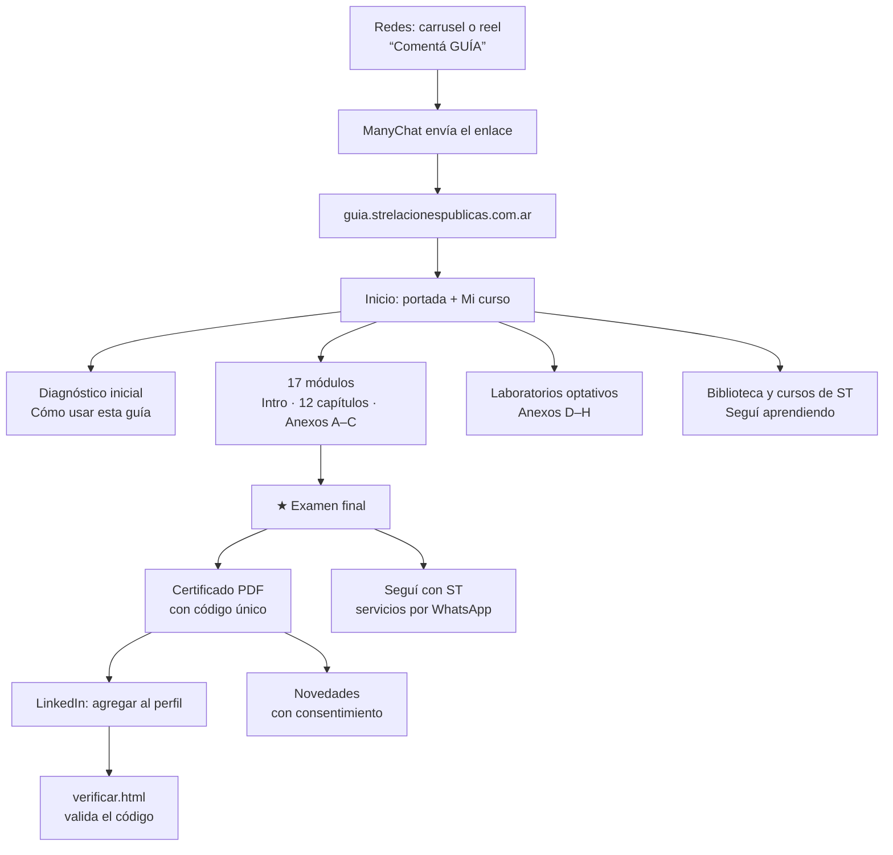

# Mapa del sitio · Guía práctica de prompting

*Referencia para armar las próximas guías de ST Relaciones Públicas. Estado al 23 de octubre de 2026.*

Este documento describe **qué tiene la guía, cómo está organizada y por qué**. Sirve para reutilizar la estructura en una guía nueva sin rehacer las decisiones. El detalle técnico para Claude está en `CLAUDE.md`.

---

## 1. Vista general

| Página | Para quién | Qué hace |
|---|---|---|
| `index.html` | Alumnos | La guía completa: inicio, módulos, examen y certificado |
| `verificar.html` | Cualquiera | Valida un certificado por su código (enlace "Mostrar credencial" de LinkedIn) |
| `privacidad.html` | Cualquiera | Política de privacidad (Ley 25.326) |
| `admin.html` | La docente | Panel de seguimiento de alumnos |
| `guia-practica-de-prompting.pdf` | Alumnos | La guía completa para descargar e imprimir |

---

## 2. Estructura del curso

**Recorrido obligatorio (17 módulos, cuentan para el certificado)**

| Grupo | Módulos | Función |
|---|---|---|
| Para empezar | Cómo usar esta guía (con diagnóstico) · Las 10 etapas | Ubicar al alumno y recomendarle por dónde ir |
| Capítulos 1 a 12 | Qué podemos crear · Método IDEA · Estructurar un prompt · Contexto · Archivos · Voz · Trabajar con Claude y Codex · Construir herramientas · Iterar · Tokens · Pruebas y seguridad · Mi proyecto paso a paso | El método, de la idea a la herramienta publicada |
| Anexos A a C | Checklist general · Laboratorio de prompts · Glosario | Herramientas de consulta |

**Examen final** (★): módulo propio después del glosario. 10 situaciones, se aprueba con 8. Adentro está el certificado.

**Laboratorios optativos (no cuentan para el certificado):** D · Proyecto guiado · E · Cuando te trabás · F · Mejorá lo que ya construiste · G · Publicar tu proyecto · H · Atajos y comandos.

**Por qué así:** el recorrido obligatorio es corto y cerrado (17 + examen), y lo práctico extra queda optativo. Así el certificado es alcanzable y la guía crece sin alargar el camino principal.

---

## 3. Anatomía de un capítulo

Todos los capítulos siguen el mismo orden. En una guía nueva, usar esta plantilla:

1. **Encabezado:** número grande, etapa del método (Intención, Diseño, Ejecución, Aseguramiento) y título.
2. **Qué vas a aprender:** tres o cuatro puntos con tilde.
3. **Explicación breve**, con recuadros visuales en lugar de párrafos largos: atención, información, tarjetas comparativas, pasos numerados.
4. **Prompt listo para usar**, con botón Copiar.
5. **Ejercicio:** campos que se guardan solos en la cuenta del alumno, con botón "Copiar mis respuestas".
6. **Errores frecuentes.**
7. **Video demostrativo** (se oculta hasta que la docente carga el enlace).
8. **Caso real · Así lo hicimos:** cómo se aplicó en un proyecto real, con el prompt escrito con el método IDEA.
9. **Lo que viene** (opcional): novedades del tema, con fecha de revisión.
10. **Antes de avanzar:** checklist del capítulo.
11. **¿Terminaste este capítulo?** y navegación anterior / siguiente.

---

## 4. El recorrido del alumno

1. **Llega** desde redes ("Comentá GUÍA") o por recomendación. Puede leer sin ingresar.
2. **Hace el diagnóstico** en "Cómo usar esta guía": la guía le recomienda por dónde empezar (con reglas fijas, sin IA).
3. **Ingresa con Google** para guardar su avance y sus respuestas en cualquier dispositivo. Lo que hizo sin cuenta se suma a su cuenta.
4. **Avanza por Mi curso:** un módulo por pantalla, barra lateral con el avance, marcador "Marcar hasta acá" y botón "Continuar".
5. **Completa ejercicios:** se guardan solos. Puede copiar sus respuestas o descargar el PDF "Mi avance".
6. **Marca cada módulo como terminado.**
7. **Rinde el examen final.** Si no llega a 8, se le indica qué repasar sin revelar las respuestas.
8. **Descarga su certificado:** se abre solo al aprobar, con un código único por persona.
9. **Lo suma a LinkedIn:** el código se valida en `verificar.html`.
10. **Sigue con ST:** servicios por WhatsApp, novedades (con su consentimiento) y cursos.

---

## 5. Lo que maneja la docente sin tocar código

| Desde | Qué |
|---|---|
| **Modo edición** (menú de la cuenta → Editar guía) | Cambiar cualquier texto · cargar los videos demostrativos · agregar videos o enlaces debajo de un bloque · cargar cursos ("Seguí aprendiendo") y recursos de la biblioteca |
| **Panel de seguimiento** (`admin.html`) | Avance de cada alumno, dónde está, respuestas, puntaje del examen, certificado (🎓), novedades (✉) · descargar CSV · copiar los correos de quienes aceptaron novedades |

**Necesita código** (pedírselo a Claude): agregar o reordenar módulos, crear ejercicios nuevos, cambiar las preguntas del examen, regenerar el PDF de la guía.

---

## 6. Datos y servicios

| Pieza | Servicio | Qué guarda o hace |
|---|---|---|
| Código | GitHub (`Strelacionespublicas/guia-prompting-st`) | Todo el sitio. Cada cambio en `main` se publica solo |
| Alojamiento | Cloudflare Pages | Publica la carpeta `site/`. Dominio propio con DNS en Hostinger |
| Ingreso | Firebase Auth (Google) | Cuentas de los alumnos |
| Base de datos | Firestore | Avance, respuestas, examen y perfil de cada alumno · ediciones de la docente · certificados emitidos |

**Por qué estos servicios:** planes gratuitos que permiten uso comercial, sin servidor propio. Netlify se dejó porque su plan gratis pasó a créditos y pausó las publicaciones; Vercel Hobby no permite uso comercial.

**Reglas de seguridad:** cada alumno ve y modifica solo sus datos; la docente lee todo desde el panel; el contenido editable lo escribe solo la docente; los certificados se verifican por código, pero no se pueden listar.

---

## 7. Captación y legales

- **Embudo:** carrusel o reel → "Comentá GUÍA" → ManyChat → guía gratuita → certificado → servicios y cursos.
- **Novedades:** casilla sin marcar en el certificado, en el menú de la cuenta y en "Seguí con ST". Se puede dar de baja.
- **Privacidad:** política propia, con los datos que se guardan, para qué y cómo ejercer los derechos (Ley 25.326).
- **Seguí con ST:** tres servicios con botón a WhatsApp, al final del examen y en el inicio cuando el certificado está listo.
- **Pie de página** con marca, enlaces legales y verificación de certificados.

---

## 8. Para la próxima guía

### Orden de armado (lo aprendido)
1. **Mapa primero:** objetivo, público, módulos, examen y recorrido del alumno, con el método IDEA. Construir sin mapa obligó a reordenar varias veces esta guía.
2. **Recorrido obligatorio corto** (tipo 17 + examen) y lo extra como optativo.
3. **Un caso de ejemplo para toda la guía** (acá: el turnero de un centro de estética).
4. **Contenido con la plantilla del capítulo** (sección 3), con recuadros visuales en lugar de párrafos largos.
5. **Examen y certificado desde el inicio**, no al final.
6. **Videos grabados antes de publicar:** sin video es un libro, no un curso.
7. **Encuesta de cierre y testimonios** con permiso (pendiente en esta guía).

### Qué se reutiliza tal cual
Ingreso con Google, avance y autoguardado, Mi curso, modo edición, panel, examen, certificado con verificación, PDF "Mi avance", biblioteca, novedades, privacidad, pie de página y diseño de marca.

### Qué hay que cambiar en una guía nueva
- Los módulos y sus contenidos (`index.html` y la lista `CHAPTERS`).
- Las preguntas del examen (`QUIZ`) y la cantidad de módulos del certificado (también en las reglas de Firestore).
- Los servicios de "Seguí con ST" y los textos del certificado.
- Un proyecto de Firebase y un proyecto de Cloudflare nuevos, con su dominio.
- Las imágenes para compartir y la política de privacidad (nombre del curso).

### Pendientes de esta guía
- [ ] Grabar y cargar los 7 videos (guiones en `docs/guiones-videos.md`).
- [ ] Cargar los primeros recursos y cursos en la biblioteca.
- [ ] Actualizar el mensaje de ManyChat (examen, certificado, Anexo H).
- [ ] Encuesta de cierre con testimonios.
- [ ] Revisar en el panel dónde se frenan los alumnos.
